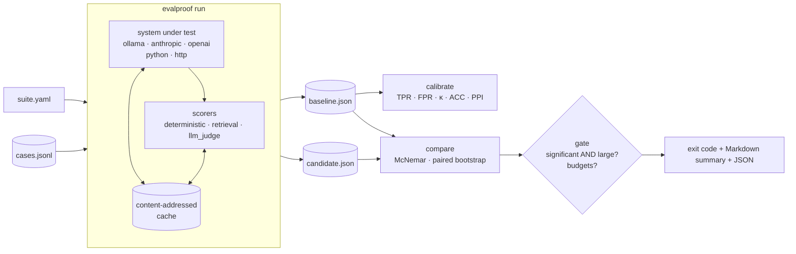

# evalproof

[](https://github.com/technobasant/evalproof/actions/workflows/ci.yml)
[](LICENSE)

[](https://evalproof.streamlit.app)

**Treat LLM evaluation as measurement.** Calibrate the judge, correct its pass rate, and
gate CI on regressions that are real rather than noise.

**Try it in the browser: [evalproof.streamlit.app](https://evalproof.streamlit.app).** Check whether
a drop between two runs is real, or replay the run below and read the twelve answers that
changed. It runs this repository's code; after a quiet spell it takes about half a minute to wake.

An LLM judge is a classifier with error rates. If it passes bad answers at rate FPR and
good answers at rate TPR, its pass rate converges to `FPR + (TPR − FPR) · p`, not to the
true rate `p`. That is classify-and-count, and it is biased the way any classifier's count
is — the effect is worked through with a seeded simulation in
[*The classifier was 95% accurate. The trend it counted was a third too flat*](https://basantbhattarai.com.np/writing/count-prevalence-not-classifications/)
([lab](https://github.com/technobasant/prevalence-shift)).

evalproof:

1. **measures the judge** against a small gold-labelled sample — confusion matrix, TPR,
   FPR, Cohen's κ;
2. **corrects its pass rate** with adjusted classify-and-count and prediction-powered
   inference, each with a confidence interval;
3. **compares runs on paired cases** — exact McNemar for pass/fail, paired bootstrap for
   scores;
4. **gates CI** only when a drop is both larger than your tolerance *and* statistically
   significant, plus latency and cost budgets, with distinct exit codes.

It is local-first: Ollama is the default provider, Anthropic and OpenAI are optional, and
every model call is cached by content so re-runs are free and reproducible.

## What it found on a real run

A local `qwen3:1.7b` support assistant for a fictional product, judged by `qwen3:8b`, 83
questions, one Apple M5. Full method and every table in [MEASUREMENTS.md](MEASUREMENTS.md).

| Question | Measured |
|---|---|
| How good is the 8B judge? | TPR 92.6%, FPR 6.7%, Cohen's κ 0.78 against the answer key |
| Did swapping the grounded prompt for a "friendly" one regress quality? | −4.8 pts on the judge, 8 cases worse vs 4 better, McNemar p = 0.39 — **gate warns, does not fail**; a delta-only gate would have failed it |
| What did regress? | p95 latency, 1,469 → 4,422 ms; mean answer 19 → 77 tokens. A 2,500 ms budget fails the change with exit 3 |
| Does correcting the judge's rate help? | On average yes (offset 4.8 → ~3.8 pts), but with 30 labels the interval doubles; at 83 cases the judge's bias is smaller than its own noise |
| Was the gold trustworthy? | No: of 13 judge–key disagreements the key was wrong 7 times, the judge 4. Most of the "bias" corrected was the gold's |
| Is pairwise judging safer? | No: 42% of verdicts flipped with the order of the two answers, and the judge preferred the candidate 42 to 6 — mostly where both answers were right and the candidate's was five times longer |
| Is it reproducible? | 20/20 identical outputs and verdicts with the cache off; a warm-cache re-run took 0.05 s instead of 363 s |

## Five-minute quickstart

```bash
git clone https://github.com/technobasant/evalproof && cd evalproof
uv sync

# Offline: no model, no network. Four versions of a ticket router.
for v in baseline regressed noisy refactored; do
  uv run evalproof run examples/deterministic/suite.yaml \
    --system "python:router:${v}_route" --out "runs/$v.json" --quiet
done
uv run evalproof compare runs/baseline.json runs/regressed.json \
  --suite examples/deterministic/suite.yaml --gate; echo "exit $?"   # 1: real regression
uv run evalproof compare runs/baseline.json runs/noisy.json \
  --suite examples/deterministic/suite.yaml --gate; echo "exit $?"   # 0: 2 of 60 is noise
```

With Ollama installed, the LLM example is
[`examples/support-qa`](examples/support-qa) (`ollama pull qwen3:1.7b` and
`ollama pull qwen3:8b`; about 6–10 minutes per run on an Apple M5).

To install the CLI elsewhere: `uv tool install git+https://github.com/technobasant/evalproof`.

The browser app in [`app/`](app) runs locally too:
`uv run --with-requirements app/requirements.txt streamlit run app/streamlit_app.py`.

## Concepts

**Suite** — one YAML file: a JSONL golden set, the system under test, scorers, an optional
judge, calibration settings and a gate.

```yaml
name: support-qa
dataset: cases.jsonl              # {"id", "input", "reference", ...extra fields}
system:
  target: ollama:qwen3:1.7b       # or anthropic:…, openai:…, python:module:func, https://…
  system_prompt_file: prompt.md
  prompt_template: "{question}"
  params: {temperature: 0, seed: 0, think: false}
judge:
  target: ollama:qwen3:8b
scorers:
  - {name: answer_key, type: regex, params: {any_of_field: accept, none_of_field: reject}}
  - {name: judge, type: llm_judge, params: {rubric_file: rubric.md}}
calibration: {judge_scorer: judge, gold_scorer: answer_key, gold_sample: 30}
gate: {metric: judge, max_drop: 0.03, alpha: 0.05, min_cases: 40, max_p95_latency_ms: 2500}
```

**Run** — `evalproof run suite.yaml` writes one self-describing JSON file: every case's
output, latency, tokens and scores, plus the dataset hash, seed, Ollama version and model
digests.

**Scorers** — `exact_match`, `contains`, `regex` (accept/reject answer keys),
`json_schema`, `numeric_tolerance`, `recall_at_k`, `mrr`, `ndcg`, and `llm_judge`: a strict
JSON verdict, one retry on an unparseable reply, and an explicit *undecided* state that is
counted, never scored as a pass. `evalproof pairwise` judges two runs head to head in both
orders and reports order-dependent verdicts as ties.

**Calibrate** — `evalproof calibrate run.json --judge-scorer judge --labels gold.jsonl`
(human labels) or `--gold-scorer answer_key --gold-sample 30`:

| Estimate | What it is |
|---|---|
| raw judge pass rate | classify-and-count, Wilson interval |
| gold labels only | the labelled sample alone |
| ACC | `(q − FPR) / (TPR − FPR)`, bootstrap interval over both the judged set and the gold sample |
| PPI | judge mean on unlabelled cases + mean (label − judge) on the gold sample, normal interval |

**Compare and gate** — `evalproof compare baseline.json candidate.json --suite suite.yaml --gate`

| Exit | Meaning |
|---|---|
| 0 | pass — possibly with warnings (a big drop that is not significant; a significant drop within tolerance) |
| 1 | quality regression: drop ≥ `max_drop` **and** p < `alpha` |
| 3 | budget breach: candidate p95 latency or cost over the limit |
| 4 | cannot gate: fewer than `min_cases` paired cases, or the runs used different data |
| 2 | usage or configuration error |

## Architecture



## Decisions

| Decision | Alternative | Why | ADR |
|---|---|---|---|
| Treat the judge as a classifier to be calibrated | Trust the judge's pass rate | Its count is biased by its own error rates, and the bias moves with the true rate | [0001](docs/adr/0001-judge-is-a-classifier.md) |
| Local Ollama by default, HTTP-only providers, content-addressed cache | Hosted APIs and vendor SDKs | Reproducible, free to re-run, tied to a model digest; no SDK dependency | [0002](docs/adr/0002-local-first-providers.md) |
| Gate on "large AND significant", on paired cases | "Fail if the score dropped by X" | On a few dozen cases, X-point drops are mostly noise, and a noisy gate gets switched off | [0003](docs/adr/0003-gate-on-significance-not-delta.md) |
| Gate one metric; report the rest | Gate every metric | Testing many metrics at α = 0.05 each inflates false failures | 0003 |
| Pointwise verdicts for gating; pairwise as a diagnostic | Pairwise preference for gating | Measured: 42% of pairwise verdicts flipped with answer order, with a strong length preference | [MEASUREMENTS §6](MEASUREMENTS.md) |
| numpy and the standard library for statistics | SciPy, statsmodels | Small enough to read and to test against hand-worked values | — |

## In CI

The composite action runs `compare --gate`, appends the report to the job summary, and
fails the job on exit codes 1, 3 or 4:

```yaml
- uses: technobasant/evalproof@v0.1.2
  with:
    baseline: eval/baseline.json     # produced on main, e.g. as a build artifact
    candidate: eval/candidate.json   # produced on this branch
    suite: eval/suite.yaml
```

This repository's own CI runs the offline example on every commit and asserts that the
gate returns 1 for the real regression and 0 for the noisy and refactored candidates.

## How it relates to other tools

[promptfoo](https://www.promptfoo.dev/docs/intro/) (open-source, local evals of prompts,
models and RAG pipelines with deterministic and model-graded assertions, a GitHub Action,
and red teaming), [DeepEval](https://deepeval.com/docs/getting-started) (pytest-style
LLM tests with research-backed metrics such as G-Eval), [Ragas](https://docs.ragas.io/en/stable/)
(LLM-driven metrics and experiments for LLM and RAG applications) and
[Inspect](https://inspect.aisi.org.uk/) (the UK AI Security Institute's framework for
model and agent evaluations, with sandboxed tools and a log viewer) are broad evaluation
frameworks.

evalproof is deliberately narrow: it is the measurement layer — how much a judge's verdict
is worth, and whether a difference between two runs is real. Its run file is plain,
documented JSON, so it can sit beside an existing harness: produce the per-case verdicts
however you like, then calibrate and gate here.

## Limits

* The measurements cover one machine, two small local models, one fictional domain and
  83 cases. They show the method; they are not a benchmark of those models.
* Calibration is only as good as its gold labels — [MEASUREMENTS §4](MEASUREMENTS.md)
  shows a regex answer key being wrong more often than the judge. Use human labels when
  the decision matters.
* ACC needs both classes in the gold sample and a judge better than chance; PPI needs the
  gold sample to be random. evalproof reports when either does not hold rather than
  printing a number.
* The percentile-bootstrap p-value for continuous scores is an approximation; pass/fail
  metrics use the exact McNemar test.
* Cost tracking needs a price table in the suite for hosted models.

## Roadmap

* Stratified gold sampling (by tag) and per-tag calibration.
* Multiple-comparison correction when more than one metric is gated.
* A reasoning judge (`think: true`) measured against the same answer key.
* Importers for other harnesses' per-case results.
* Publishing to PyPI.

## Licence

Apache-2.0. See [LICENSE](LICENSE) and [NOTICE](NOTICE).
