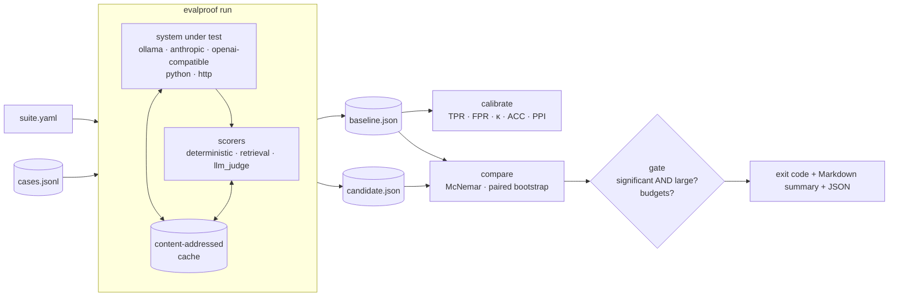

# evalproof

[](https://pypi.org/project/evalproof/)
[](https://pypi.org/project/evalproof/)
[](https://github.com/technobasant/evalproof/actions/workflows/ci.yml)
[](LICENSE)
[](https://evalproof.streamlit.app)

**Treat LLM evaluation as measurement.** Calibrate the judge, correct its pass rate, and
gate CI on regressions that are real rather than noise.

**Try it in the browser: [evalproof.streamlit.app](https://evalproof.streamlit.app).** Check whether
a drop between two runs is real, or replay the run below and read the twelve answers that
changed. It runs this repository's code; after a quiet spell it takes about half a minute to wake.

An LLM judge is a classifier with error rates. If it passes bad answers at rate FPR and
good answers at rate TPR, its pass rate converges to `FPR + (TPR − FPR) · p`, not to the
true rate `p`. That is classify-and-count, and it is biased the way any classifier's count
is — the effect is worked through with a seeded simulation in
[*The classifier was 95% accurate. The trend it counted was a third too flat*](https://basantbhattarai.com.np/writing/count-prevalence-not-classifications/)
([lab](https://github.com/technobasant/prevalence-shift)).

evalproof:

1. **measures the judge** against a small gold-labelled sample — confusion matrix, TPR,
   FPR, Cohen's κ;
2. **corrects its pass rate** with adjusted classify-and-count and prediction-powered
   inference, each with a confidence interval;
3. **compares runs on paired cases** — exact McNemar for pass/fail, paired bootstrap for
   scores;
4. **gates CI** only when a drop is both larger than your tolerance *and* statistically
   significant, plus latency and cost budgets, with distinct exit codes.

It is local-first: Ollama is the default, every major hosted provider is one `target:` line
away ([Providers](#providers)), and every model call is cached by content so re-runs are free
and reproducible.

## Install

```bash
pip install evalproof          # or: uv add evalproof
uv tool install evalproof      # just the CLI
```

Python 3.11 to 3.14. `compare`, `calibrate` and `report` work on run files and need no
model. `run` needs a system to evaluate: a Python function, an HTTP endpoint, a local model
(Ollama, vLLM, LM Studio, llama.cpp), or a key for a hosted provider.

## What it found on a real run

A local `qwen3:1.7b` product support assistant, judged by `qwen3:8b`, 83
questions, one Apple M5. Full method and every table in [MEASUREMENTS.md](MEASUREMENTS.md).

| Question | Measured |
|---|---|
| How good is the 8B judge? | TPR 92.6%, FPR 6.7%, Cohen's κ 0.78 against the answer key |
| Did swapping the grounded prompt for a "friendly" one regress quality? | −4.8 pts on the judge, 8 cases worse vs 4 better, McNemar p = 0.39 — **gate warns, does not fail**; a delta-only gate would have failed it |
| What did regress? | p95 latency, 1,469 → 4,422 ms; mean answer 19 → 77 tokens. A 2,500 ms budget fails the change with exit 3 |
| Does correcting the judge's rate help? | On average yes (offset 4.8 → ~3.8 pts), but with 30 labels the interval doubles; at 83 cases the judge's bias is smaller than its own noise |
| Was the gold trustworthy? | No: of 13 judge–key disagreements the key was wrong 7 times, the judge 4. Most of the "bias" corrected was the gold's |
| Is pairwise judging safer? | No: 42% of verdicts flipped with the order of the two answers, and the judge preferred the candidate 42 to 6 — mostly where both answers were right and the candidate's was five times longer |
| Does a reasoning judge help? | Against audited labels, yes: thinking on passed no wrong answer (three without it) and κ rose from 0.86–0.88 to 0.90–0.94, at 6.7× the judge time. Against the raw answer key it looked worse, because the key is wrong on exactly those cases. The gate's decision did not change |
| Is it reproducible? | 20/20 identical outputs and verdicts with the cache off; a warm-cache re-run took 0.05 s instead of 363 s; a re-judge three days later matched 83/83 |

## Five-minute quickstart

The offline example lives in the repository:

```bash
git clone https://github.com/technobasant/evalproof && cd evalproof
uv sync

# Offline: no model, no network. Four versions of a ticket router.
for v in baseline regressed noisy refactored; do
  uv run evalproof run examples/deterministic/suite.yaml \
    --system "python:router:${v}_route" --out "runs/$v.json" --quiet
done
uv run evalproof compare runs/baseline.json runs/regressed.json \
  --suite examples/deterministic/suite.yaml --gate; echo "exit $?"   # 1: real regression
uv run evalproof compare runs/baseline.json runs/noisy.json \
  --suite examples/deterministic/suite.yaml --gate; echo "exit $?"   # 0: 2 of 60 is noise
```

[`examples/retrieval`](examples/retrieval) runs the same gate on a retrieval change: recall@5
does not move when the top hit drops to rank 5, while MRR and nDCG@5 do, and the gate fails
it. It was contributed by [@HarshRajSinghania](https://github.com/HarshRajSinghania), and CI
checks its exit codes too.

With Ollama installed, the LLM example is
[`examples/support-qa`](examples/support-qa) (`ollama pull qwen3:1.7b` and
`ollama pull qwen3:8b`; about 6–10 minutes per run on an Apple M5).

The browser app in [`app/`](app) runs locally too:
`uv run --with-requirements app/requirements.txt streamlit run app/streamlit_app.py`.

## Providers

The target is `<provider>:<model>`; the model name is everything after the first colon, so
`openrouter:anthropic/claude-sonnet-4.5` and `ollama:qwen3:8b` both work. Two native adapters
(`ollama`, `anthropic`) and one OpenAI-compatible adapter driven by a table of provider
profiles ([`providers/profiles.py`](src/evalproof/providers/profiles.py), each row cites the
provider's documentation). Plain HTTP throughout, no vendor SDK.

| Provider | Example target | Key variable | Where |
|---|---|---|---|
| `ollama` | `ollama:qwen3:8b` | none | local |
| `vllm` | `vllm:meta-llama/Llama-3.1-8B-Instruct` | `VLLM_API_KEY`, optional | local |
| `lmstudio` | `lmstudio:qwen3-8b` | optional, via `api_key_env` | local |
| `llamacpp` | `llamacpp:qwen3-8b` | `LLAMA_API_KEY`, optional | local |
| `anthropic` | `anthropic:claude-sonnet-4-5` | `ANTHROPIC_API_KEY` | hosted |
| `openai` | `openai:gpt-5` | `OPENAI_API_KEY` | hosted |
| `azure` | `azure:<deployment>` | `AZURE_OPENAI_API_KEY` | hosted, needs `base_url` |
| `gemini` | `gemini:gemini-2.5-flash` | `GEMINI_API_KEY` | hosted |
| `mistral` | `mistral:mistral-large-latest` | `MISTRAL_API_KEY` | hosted |
| `groq` | `groq:llama-3.3-70b-versatile` | `GROQ_API_KEY` | hosted |
| `together` | `together:meta-llama/Llama-3.3-70B-Instruct-Turbo` | `TOGETHER_API_KEY` | hosted |
| `fireworks` | `fireworks:accounts/fireworks/models/llama-v3p3-70b-instruct` | `FIREWORKS_API_KEY` | hosted |
| `deepseek` | `deepseek:deepseek-chat` | `DEEPSEEK_API_KEY` | hosted |
| `xai` | `xai:grok-4` | `XAI_API_KEY` | hosted |
| `openrouter` | `openrouter:anthropic/claude-sonnet-4.5` | `OPENROUTER_API_KEY` | hosted |
| `cerebras` | `cerebras:gpt-oss-120b` | `CEREBRAS_API_KEY` | hosted |
| `openai-compatible` | `openai-compatible:<model>` | optional, via `api_key_env` | any server, needs `base_url` |

```yaml
system:
  target: openai-compatible:gpt-4o    # a gateway, LiteLLM proxy, TGI, SGLang, ...
  base_url: https://llm-gateway.internal/v1
  api_key_env: TEAM_GATEWAY_KEY       # the variable to read; the key itself never goes in the suite
  headers: {x-team: search}           # extra HTTP headers on every call, never secrets
  params: {max_tokens: 2048}
```

* `base_url` overrides any profile's default (a regional endpoint, a proxy, an older
  `llama-server`, which listened on port 8080 before October 2026 and now defaults to 9931).
* `api_key_env` replaces the profile's variable for any provider; a variable named there
  must be set.
* `headers` merge into every request and win over the adapter's own, for example
  `anthropic-version`. They are not part of the cache key, and a suite file is usually
  committed, so keep keys in the environment.
* Sampling: local servers (`ollama`, `vllm`, `lmstudio`, `llamacpp`) receive `temperature` and
  `seed` on every call, defaults included, so a local run repeats. Hosted providers receive
  them only when `params` sets them, because reasoning models reject a non-default
  temperature; Anthropic never receives a seed, and since its current models also reject
  `temperature`, it gets one only when the suite asks. `params.extra` adds any other body
  field, such as `{thinking: {type: adaptive}, output_config: {effort: low}}`.
* Thinking models spend output tokens on thinking inside `max_tokens`, which defaults to 512
  (changing it would change every cache key). Set `params.max_tokens` higher for them; a reply
  cut off before its first word, a refusal, or a content-filter block is recorded as that
  case's error rather than as an empty answer.
* AWS Bedrock and Google Vertex AI sign requests with cloud credentials, which evalproof does
  not implement. Use a gateway's OpenAI-compatible endpoint through `openai-compatible`.

## Concepts

**Suite** — one YAML file: a JSONL golden set, the system under test, scorers, an optional
judge, calibration settings and a gate.

```yaml
name: support-qa
dataset: cases.jsonl              # {"id", "input", "reference", ...extra fields}
system:
  target: ollama:qwen3:1.7b       # or groq:…, anthropic:…, python:module:func, https://…
  system_prompt_file: prompt.md
  prompt_template: "{question}"
  params: {temperature: 0, seed: 0, think: false}
judge:
  target: ollama:qwen3:8b
scorers:
  - {name: answer_key, type: regex, params: {any_of_field: accept, none_of_field: reject}}
  - {name: judge, type: llm_judge, params: {rubric_file: rubric.md}}
calibration: {judge_scorer: judge, gold_scorer: answer_key, gold_sample: 30}
gate: {metric: judge, max_drop: 0.03, alpha: 0.05, min_cases: 40, max_p95_latency_ms: 2500}
```

**Run** — `evalproof run suite.yaml` writes one self-describing JSON file: every case's
output, latency, tokens and scores, plus the dataset hash, seed, Ollama version and model
digests.

**Scorers** — `exact_match`, `contains`, `regex` (accept/reject answer keys),
`json_schema`, `numeric_tolerance`, `recall_at_k`, `mrr`, `ndcg`, and `llm_judge`: a strict
JSON verdict, one retry on an unparseable reply, and an explicit *undecided* state that is
counted, never scored as a pass. `evalproof pairwise` judges two runs head to head in both
orders and reports order-dependent verdicts as ties.

**Calibrate** — `evalproof calibrate run.json --judge-scorer judge --labels gold.jsonl`
(human labels) or `--gold-scorer answer_key --gold-sample 30`:

| Estimate | What it is |
|---|---|
| raw judge pass rate | classify-and-count, Wilson interval |
| gold labels only | the labelled sample alone |
| ACC | `(q − FPR) / (TPR − FPR)`, bootstrap interval over both the judged set and the gold sample |
| PPI | judge mean on unlabelled cases + mean (label − judge) on the gold sample, normal interval |

**Compare and gate** — `evalproof compare baseline.json candidate.json --suite suite.yaml --gate`

| Exit | Meaning |
|---|---|
| 0 | pass — possibly with warnings (a big drop that is not significant; a significant drop within tolerance) |
| 1 | quality regression: drop ≥ `max_drop` **and** p < `alpha` |
| 3 | budget breach: candidate p95 latency or cost over the limit |
| 4 | cannot gate: fewer than `min_cases` paired cases, or the runs used different data |
| 2 | usage or configuration error |

The gate checks one metric by default. To gate several, repeat `--metric` or list them in
the suite; each metric's p-value is then Holm-adjusted for the number of metrics gated, so
the chance of failing a build on noise stays at `alpha` for the set as a whole, and the
report shows the raw and the adjusted p-value side by side. Metrics that are not gated are
still reported.

```yaml
gate:
  metrics: [judge, answer_key]   # one metric: `metric: judge`
  max_drop: 0.03
  alpha: 0.05
  min_cases: 40
```

```bash
evalproof compare baseline.json candidate.json --gate --metric judge --metric answer_key
```

## Import results from other tools

You do not have to run your evals with evalproof to gate them. `evalproof import` turns the
per-case results another tool wrote into a run file that `compare` and the gate read:

```bash
evalproof import promptfoo output.json --system openai:gpt-5 --out runs/candidate.json
evalproof import inspect logs/task.eval --out runs/candidate.json
evalproof import deepeval .deepeval/.latest_test_run.json --out runs/candidate.json
evalproof import lm-eval results/gpt2/samples_hellaswag_2026-11-12T10-20-30.jsonl --out runs/gpt2.json
evalproof import csv results.csv --system a --out runs/a.json       # id,metric,passed,score,...
evalproof import jsonl results.jsonl --wide --id-field case --out runs/a.json  # one column per metric
```

Import each side with the same importer, then gate as usual, for example
`evalproof compare runs/baseline.json runs/candidate.json --gate --metric pass`. What to know:

* Case ids are stable between runs of the same dataset (they come from the test's inputs, or
  the tool's own sample id, never from its position), which is what lets two files pair.
  The dataset hash covers the ids and inputs as the tool recorded them, so runs imported by
  different importers refuse to gate (exit 4) instead of pairing on a coincidence.
* A system error counts as a failure on every metric, as in a native run. Repeats of one case
  (epochs, repeated tests) collapse by `--epochs`: `mean` (the default), `first`, `all`
  or `any`. Under `mean`, `first` and `any`, a case with at least one repeat that ran is not
  counted as a system error; its errored repeats still score as failures.
* A NaN or infinite score is refused at import, naming the case and metric, because it would
  make the bootstrap report a significant difference that is not there.
* promptfoo files can hold several providers and `--system` picks one. Inspect `.eval` logs
  compressed with zstd need Python 3.14 or newer; otherwise run
  `inspect log convert --to json <file>` first. DeepEval's conversational cases are skipped
  with a warning.

## From Python

The CLI is a thin layer over the same functions:

```python
from evalproof import GateConfig, calibrate, compare_runs, decide, load_run

baseline = load_run("runs/baseline.json")
candidate = load_run("runs/candidate.json")

cmp = compare_runs(baseline, candidate)  # paired cases: exact McNemar, bootstrap intervals
decision = decide(cmp, GateConfig(metric="judge", max_drop=0.03))
print(decision.status, decision.exit_code, decision.warnings)

report = calibrate(baseline, "judge", gold_scorer="answer_key", gold_sample=30)
for est in report.estimates:  # raw judge rate, gold only, ACC, PPI
    print(est.method, est.point, est.low, est.high)
```

The names in `evalproof.__all__` are the supported API. Other modules are internal and may
change between minor versions; see the [changelog](CHANGELOG.md).

## Architecture



## Decisions

| Decision | Alternative | Why | ADR |
|---|---|---|---|
| Treat the judge as a classifier to be calibrated | Trust the judge's pass rate | Its count is biased by its own error rates, and the bias moves with the true rate | [0001](docs/adr/0001-judge-is-a-classifier.md) |
| Local Ollama by default, HTTP-only providers, content-addressed cache | Hosted APIs and vendor SDKs | Reproducible, free to re-run, tied to a model digest; no SDK dependency | [0002](docs/adr/0002-local-first-providers.md) |
| Gate on "large AND significant", on paired cases | "Fail if the score dropped by X" | On a few dozen cases, X-point drops are mostly noise, and a noisy gate gets switched off | [0003](docs/adr/0003-gate-on-significance-not-delta.md) |
| One metric by default; several with Holm correction | Gate every metric at α each | Testing many metrics at α = 0.05 each inflates false failures | 0003 |
| Pointwise verdicts for gating; pairwise as a diagnostic | Pairwise preference for gating | Measured: 42% of pairwise verdicts flipped with answer order, with a strong length preference | [MEASUREMENTS §6](MEASUREMENTS.md) |
| numpy and the standard library for statistics | SciPy, statsmodels | Small enough to read and to test against hand-worked values | — |

## In CI

The composite action runs `compare --gate`, appends the report to the job summary, and
fails the job on exit codes 1, 3 or 4:

```yaml
- uses: technobasant/evalproof@v0.3.0
  with:
    baseline: eval/baseline.json     # produced on main, e.g. as a build artifact
    candidate: eval/candidate.json   # produced on this branch
    suite: eval/suite.yaml
    # metric: "judge, answer_key"    # optional: gate several metrics, newline- or comma-separated
```

This repository's own CI runs the offline example on every commit and asserts that the
gate returns 1 for the real regression and 0 for the noisy and refactored candidates.

## How it relates to other tools

[promptfoo](https://www.promptfoo.dev/docs/intro/) (open-source, local evals of prompts,
models and RAG pipelines with deterministic and model-graded assertions, a GitHub Action,
and red teaming), [DeepEval](https://deepeval.com/docs/getting-started) (pytest-style
LLM tests with research-backed metrics such as G-Eval), [Ragas](https://docs.ragas.io/en/stable/)
(LLM-driven metrics and experiments for LLM and RAG applications) and
[Inspect](https://inspect.aisi.org.uk/) (the UK AI Security Institute's framework for
model and agent evaluations, with sandboxed tools and a log viewer) are broad evaluation
frameworks.

evalproof is deliberately narrow: it is the measurement layer — how much a judge's verdict
is worth, and whether a difference between two runs is real. Its run file is plain,
documented JSON, so it can sit beside an existing harness: produce the per-case verdicts
however you like, then calibrate and gate here. For promptfoo, Inspect, DeepEval and
lm-eval you do not even need to do that: evalproof [imports their results](#import-results-from-other-tools).

## Limits

* The measurements cover one machine, two small local models, one product domain and
  83 cases. They show the method; they are not a benchmark of those models.
* Calibration is only as good as its gold labels — [MEASUREMENTS §4](MEASUREMENTS.md)
  shows a regex answer key being wrong more often than the judge. Use human labels when
  the decision matters.
* ACC needs both classes in the gold sample and a judge better than chance; PPI needs the
  gold sample to be random. evalproof reports when either does not hold rather than
  printing a number.
* The percentile-bootstrap p-value for continuous scores is an approximation; pass/fail
  metrics use the exact McNemar test.
* Cost tracking needs a price table in the suite for hosted models.

## Roadmap

* Stratified gold sampling (by tag) and per-tag calibration.

## Project

[Changelog](CHANGELOG.md) · [Contributing](CONTRIBUTING.md) ·
[Security policy](SECURITY.md) · [Code of conduct](CODE_OF_CONDUCT.md) ·
[How to cite](CITATION.cff). Releases are published to PyPI from GitHub Actions with
[trusted publishing](https://docs.pypi.org/trusted-publishers/), and each file carries a
signed provenance attestation.

## Licence

Apache-2.0. See [LICENSE](LICENSE) and [NOTICE](NOTICE).
