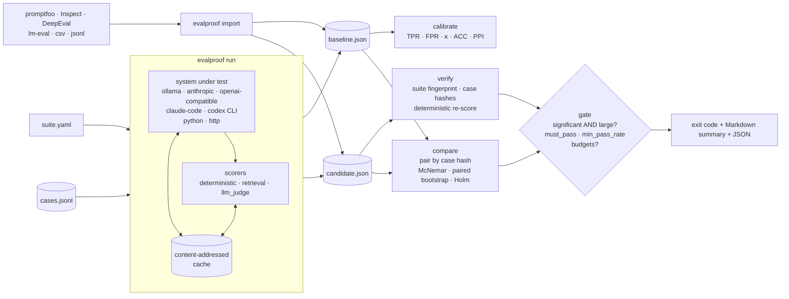

# evalproof

[](https://pypi.org/project/evalproof/)
[](https://pypi.org/project/evalproof/)
[](https://github.com/technobasant/evalproof/actions/workflows/ci.yml)
[](LICENSE)
[](https://evalproof.streamlit.app)

**Treat LLM evaluation as measurement.** Calibrate the judge, correct its pass rate, and
gate CI on regressions that are real rather than noise.

**Try it in the browser: [evalproof.streamlit.app](https://evalproof.streamlit.app).** Check whether
a drop between two runs is real, or replay the run below and read the twelve answers that
changed. It runs this repository's code; after a quiet spell it takes about half a minute to wake.

An LLM judge is a classifier with error rates. If it passes bad answers at rate FPR and
good answers at rate TPR, its pass rate converges to `FPR + (TPR − FPR) · p`, not to the
true rate `p`. That is classify-and-count, and it is biased the way any classifier's count
is — the effect is worked through with a seeded simulation in
[*The classifier was 95% accurate. The trend it counted was a third too flat*](https://basantbhattarai.com.np/writing/count-prevalence-not-classifications/)
([lab](https://github.com/technobasant/prevalence-shift)).

evalproof:

1. **measures the judge** against a small gold-labelled sample — confusion matrix, TPR,
   FPR, Cohen's κ;
2. **corrects its pass rate** with adjusted classify-and-count and prediction-powered
   inference, each with a confidence interval;
3. **compares runs on paired cases** — exact McNemar for pass/fail, paired bootstrap for
   scores;
4. **gates CI** only when a drop is both larger than your tolerance *and* statistically
   significant, plus latency and cost budgets, with distinct exit codes;
5. **checks the run files it gates** — `verify` proves, with no model call, that a committed
   run was made with this suite and covers the dataset as it is now.

It is local-first: Ollama is the default, every major hosted provider is one `target:` line
away ([Providers](#providers)), a logged-in Claude Code or Codex can be the judge with no API
key, and every model call is cached by content so re-runs are free and reproducible. Results
from promptfoo, Inspect, DeepEval and lm-eval can be [imported](#import-results-from-other-tools)
and gated without re-running them.

## Install

evalproof is a command-line tool and a Python library, published on
[PyPI](https://pypi.org/project/evalproof/). It needs Python 3.11 to 3.14 and has four runtime
dependencies (httpx, numpy, pydantic, PyYAML); no vendor SDK, no optional extras.

**Run it without installing** (needs [uv](https://docs.astral.sh/uv/)):

```bash
uvx evalproof --version
uvx evalproof@0.5.2 init          # pin a version
```

**Install the CLI** on your `PATH`, isolated from your projects:

```bash
uv tool install evalproof         # or: pipx install evalproof
evalproof --version               # evalproof 0.5.2
```

**Add it to a project**, to call it from Python or pin it with the project's other dev tools:

```bash
uv add --dev evalproof            # or: pip install evalproof
uv run evalproof --version
```

**Upgrade** with `uv tool upgrade evalproof`, `pipx upgrade evalproof` or
`pip install -U evalproof`. Run files from older versions keep working; see the
[changelog](CHANGELOG.md) for what changed.

**In GitHub Actions**, no install step is needed: the composite action
`technobasant/evalproof@v0.5.2` runs the evalproof of the tag you pin ([In CI](#in-ci)).

What else you need depends on what you run:

| To | You need |
|---|---|
| `compare`, `calibrate`, `verify`, `rehash`, `report`, `import`, `init`, `doctor`, `readiness` | nothing: they read run files and make no model call |
| `run` against a Python function or an HTTP endpoint | that function or endpoint |
| `run` on a local model | [Ollama](https://ollama.com) (the default), vLLM, LM Studio or llama.cpp, with the model pulled |
| `run` on a hosted model | the provider's key in an environment variable ([Providers](#providers)) |
| `run` with your Claude Code or Codex login | the `claude` or `codex` CLI on your `PATH`, logged in; check with `evalproof doctor` |

## What it needs to run

Which credential a run needs depends on what the system and the judge are. **Keyless mode needs no
secrets:** CI compares run files you committed and makes no model call. Fork pull requests never
receive secrets, so no workflow runs a model for them.

| Target | Credential variable | Local use | CI use | Where allowed |
|---|---|---|---|---|
| No model: a Python function or an HTTP endpoint with no LLM behind it, or committed run files | none | nothing | nothing | anywhere, including fork pull requests |
| Local models (Ollama, vLLM, LM Studio, llama.cpp) | none | the server running, with the model pulled | a server on the runner, started in a workflow step | anywhere |
| Hosted APIs (Anthropic, OpenAI and the rest of [Providers](#providers)) | the provider's key, such as `ANTHROPIC_API_KEY` or `OPENAI_API_KEY` | the variable in your environment | the key as a repository secret | your own repository; fork pull requests never receive it |
| Claude Code CLI | `ANTHROPIC_API_KEY` (api-key mode) or `CLAUDE_CODE_OAUTH_TOKEN` | your Claude Code login, no variable | `ANTHROPIC_API_KEY` as a secret with `EVALPROOF_CLI_AUTH=api-key`, or `CLAUDE_CODE_OAUTH_TOKEN` as a secret (made by `claude setup-token`) | the token: your own repository and your own CI only; use an API key for a secret shared across a team or an organisation |
| Codex CLI | `OPENAI_API_KEY` | your Codex login, no variable | `OPENAI_API_KEY` as a secret with `EVALPROOF_CLI_AUTH=api-key` | a personal Codex login only on trusted private infrastructure, never on public repos or for open source work |

`evalproof init --ci api-key` writes the workflow with the secret for the judge it chose, and
prints this requirement for that judge when it finishes. For Claude Code,
`evalproof init --ci api-key --cli-auth oauth-token` passes `CLAUDE_CODE_OAUTH_TOKEN` instead of
the API key and warns that it is for your own repository and CI only; Codex has no token option.
`evalproof doctor` prints, for each CLI target, which credential it would use here and whether
that works in CI ("login only, not available in CI", or usable from a secret). It looks at the
names of environment variables, never at their values.

## Use cases

Each of these is a suite file and one or two commands. The [quickstart](#five-minute-quickstart)
writes a starting suite.

**Gate a prompt or model change in a pull request.** Run the suite on the base branch and on the
change, then gate. The build fails only when the drop is larger than `max_drop` *and*
significant, so a two-case wobble on 60 cases does not block a merge:

```bash
evalproof run evals/suite.yaml --out base.json                     # on main
evalproof run evals/suite.yaml --out cand.json                     # on the branch
evalproof compare base.json cand.json --suite evals/suite.yaml --gate --show 5
```

**Choose between two models or providers.** Run the same suite with `--system` and compare the
two runs. The report gives the paired difference with its interval and p-value, the cases that
got worse, p95 latency and cost, so "cheaper and not measurably worse" is something you can show:

```bash
evalproof run evals/suite.yaml --system anthropic:claude-sonnet-4-5 --label sonnet --out a.json
evalproof run evals/suite.yaml --system groq:llama-3.3-70b-versatile --label llama --out b.json
evalproof compare a.json b.json --suite evals/suite.yaml
```

**Find out whether your LLM judge can be trusted.** Label 30 to 50 cases by hand
(`{"id": ..., "label": true}` per line) and calibrate. You get the judge's TPR, FPR and
Cohen's κ, and its pass rate corrected for those errors, each with an interval:

```bash
evalproof calibrate runs/latest.json --judge-scorer judge --labels gold.jsonl
```

**Use your Claude Code or Codex subscription as the judge.** Set `judge.target:
claude-code:haiku` (or `codex:<model>`), run `evalproof doctor evals/suite.yaml`, and run as
usual. No API key and no per-call bill; the CLI runs isolated, with no tools and none of your
project's instructions ([details](#use-your-claude-code-or-codex-login)).

**Gate results you already have from another eval tool.** Import each side, then compare as
usual. Nothing is re-run:

```bash
evalproof import promptfoo main/output.json --out base.json
evalproof import promptfoo pr/output.json --out cand.json
evalproof compare base.json cand.json --gate --metric pass
```

**Check a retrieval or RAG change.** Score the ranked ids with `recall_at_k`, `mrr` and `ndcg`
and gate on the one that matters to you. Recall@5 does not move when the right document drops
from rank 1 to rank 5; MRR and nDCG do ([`examples/retrieval`](examples/retrieval)).

**Cases that must never fail, and a floor on the first run.** Tag the critical cases and set
`gate.must_pass: [critical]` and `gate.min_pass_rate`. They need no baseline, so they work
from the first run: `evalproof run evals/suite.yaml --gate` exits 1 when one fails
([Checks without a baseline](#concepts)).

**Hold latency and cost while you swap a model.** `gate.max_p95_latency_ms` and
`gate.max_cost_usd` fail a change with exit 3, separate from a quality regression. On the
measured run below, a prompt change that was not a significant quality drop still failed on
latency.

**Gate in CI with no model calls and no secrets.** `evalproof init --ci keyless` writes a
workflow that compares the run file developers commit against the base branch's.
The action runs `verify` first, so a stale run, a `--limit` run or a hand-edited
deterministic score fails the job ([In CI](#in-ci)).

**Test a non-LLM system the same way.** Any Python function (`python:module:func`) or HTTP
endpoint can be the system, scored by deterministic scorers: a classifier, a router, a search
service. The [offline example](#five-minute-quickstart) is a keyword router.

## What it found on a real run

A local `qwen3:1.7b` product support assistant, judged by `qwen3:8b`, 83
questions, one Apple M5. Full method and every table in [MEASUREMENTS.md](MEASUREMENTS.md).

| Question | Measured |
|---|---|
| How good is the 8B judge? | TPR 92.6%, FPR 6.7%, Cohen's κ 0.78 against the answer key |
| Did swapping the grounded prompt for a "friendly" one regress quality? | −4.8 pts on the judge, 8 cases worse vs 4 better, McNemar p = 0.39 — **gate warns, does not fail**; a delta-only gate would have failed it |
| What did regress? | p95 latency, 1,469 → 4,422 ms; mean answer 19 → 77 tokens. A 2,500 ms budget fails the change with exit 3 |
| Does correcting the judge's rate help? | On average yes (offset 4.8 → ~3.8 pts), but with 30 labels the interval doubles; at 83 cases the judge's bias is smaller than its own noise |
| Was the gold trustworthy? | No: of 13 judge–key disagreements the key was wrong 7 times, the judge 4. Most of the "bias" corrected was the gold's |
| What changes with reviewed labels? | On a random 30, the key was wrong once. That one case moved the corrected rate 3 points, the wrong way for this sample, and showed the judge's FPR at 25%, not 14%. A reasoning judge reached κ 0.91 against the reviewed labels where the key scored both judges 0.81 |
| Is pairwise judging safer? | No: 42% of verdicts flipped with the order of the two answers, and the judge preferred the candidate 42 to 6 — mostly where both answers were right and the candidate's was five times longer |
| Does a reasoning judge help? | Against audited labels, yes: thinking on passed no wrong answer (three without it) and κ rose from 0.86–0.88 to 0.90–0.94, at 6.7× the judge time. Against the raw answer key it looked worse, because the key is wrong on exactly those cases. The gate's decision did not change |
| Is it reproducible? | 20/20 identical outputs and verdicts with the cache off; a warm-cache re-run took 0.05 s instead of 363 s; a re-judge three days later matched 83/83 |

## Five-minute quickstart

In your own repository, one command writes a starter suite, a CI workflow and an agent skill,
and a second runs it:

```bash
uvx evalproof init
uvx evalproof run evals/suite.yaml --out evals/runs/latest.json
```

`init` picks the judge from what is on your `PATH`: a logged-in `claude`, then `codex`, then
Ollama, then a hosted Anthropic model with `ANTHROPIC_API_KEY`. It writes `evals/` (the
suite, three sample cases, a README), `.github/workflows/evalproof.yml` (`--ci keyless`, the
default, makes no model calls in CI; `--ci api-key` runs the suite there; `--ci none` writes
no workflow) and a skill for coding agents at `.agents/skills/evalproof/SKILL.md` and
`.claude/skills/evalproof/SKILL.md` (`--no-skill` skips it). It prints one line per file,
never overwrites one without `--force`, and makes no model call. Replace the sample cases
with your own: the gate needs 20 before it will decide.

The offline example lives in the repository:

```bash
git clone https://github.com/technobasant/evalproof && cd evalproof
uv sync

# Offline: no model, no network. Four versions of a ticket router.
for v in baseline regressed noisy refactored; do
  uv run evalproof run examples/deterministic/suite.yaml \
    --system "python:router:${v}_route" --out "runs/$v.json" --quiet
done
uv run evalproof compare runs/baseline.json runs/regressed.json \
  --suite examples/deterministic/suite.yaml --gate; echo "exit $?"   # 1: real regression
uv run evalproof compare runs/baseline.json runs/noisy.json \
  --suite examples/deterministic/suite.yaml --gate; echo "exit $?"   # 0: 2 of 60 is noise
```

[`examples/retrieval`](examples/retrieval) runs the same gate on a retrieval change: recall@5
does not move when the top hit drops to rank 5, while MRR and nDCG@5 do, and the gate fails
it. It was contributed by [@HarshRajSinghania](https://github.com/HarshRajSinghania), and CI
checks its exit codes too.

With Ollama installed, the LLM example is
[`examples/support-qa`](examples/support-qa) (`ollama pull qwen3:1.7b` and
`ollama pull qwen3:8b`; about 6–10 minutes per run on an Apple M5).

The browser app in [`app/`](app) runs locally too:
`uv run --with-requirements app/requirements.txt streamlit run app/streamlit_app.py`.

### Commands

| Command | What it does |
|---|---|
| `evalproof init` | write a starter suite, a CI workflow and an agent skill; no model call |
| `evalproof run SUITE` | run the suite and write a run file; `--gate` applies the baseline-free checks (`min_pass_rate`, `must_pass`); `--show N` lists N failed cases |
| `evalproof compare BASE CAND` | compare two runs on paired cases; `--gate` turns the result into an exit code; `--show N` prints both answers for N regressed cases |
| `evalproof verify RUN SUITE` | check, with no model call, that a run file was made with this suite, covers exactly the dataset's cases as they are now, and has the scores its deterministic scorers give the stored outputs |
| `evalproof rehash RUN SUITE` | add per-case hashes to a run file written before 0.5, from the dataset it scored; no model call |
| `evalproof report RUN` | print a run file's report |
| `evalproof import FORMAT FILE` | turn another tool's results into a run file |
| `evalproof calibrate RUN` | measure the judge against gold labels and correct its pass rate |
| `evalproof pairwise A B` | judge two runs head to head, in both orders |
| `evalproof doctor [SUITE]` | check the agent CLIs a suite uses; no model call |
| `evalproof readiness SUITE [--run FILE] [--json] [--require DIM,...]` | report which parts of quality the suite covers (correctness, tool use, quality, gate, cost, safety, and so on) and which it leaves untested; exits 1 when a `--require`d one is not covered; no model call |

## Providers

The target is `<provider>:<model>`; the model name is everything after the first colon, so
`openrouter:anthropic/claude-sonnet-4.5` and `ollama:qwen3:8b` both work. Two native adapters
(`ollama`, `anthropic`) and one OpenAI-compatible adapter driven by a table of provider
profiles ([`providers/profiles.py`](src/evalproof/providers/profiles.py), each row cites the
provider's documentation). Plain HTTP throughout, no vendor SDK. Two more targets run a coding
agent you already have logged in, `claude-code` and `codex`: see
[Use your Claude Code or Codex login](#use-your-claude-code-or-codex-login). Three experimental
ones run OpenCode, Cursor and GitHub Copilot the same way: see
[Experimental providers](#experimental-providers).

| Provider | Example target | Key variable | Where |
|---|---|---|---|
| `ollama` | `ollama:qwen3:8b` | none | local |
| `vllm` | `vllm:meta-llama/Llama-3.1-8B-Instruct` | `VLLM_API_KEY`, optional | local |
| `lmstudio` | `lmstudio:qwen3-8b` | optional, via `api_key_env` | local |
| `llamacpp` | `llamacpp:qwen3-8b` | `LLAMA_API_KEY`, optional | local |
| `anthropic` | `anthropic:claude-sonnet-4-5` | `ANTHROPIC_API_KEY` | hosted |
| `openai` | `openai:gpt-5` | `OPENAI_API_KEY` | hosted |
| `azure` | `azure:<deployment>` | `AZURE_OPENAI_API_KEY` | hosted, needs `base_url` |
| `gemini` | `gemini:gemini-2.5-flash` | `GEMINI_API_KEY` | hosted |
| `mistral` | `mistral:mistral-large-latest` | `MISTRAL_API_KEY` | hosted |
| `groq` | `groq:llama-3.3-70b-versatile` | `GROQ_API_KEY` | hosted |
| `together` | `together:meta-llama/Llama-3.3-70B-Instruct-Turbo` | `TOGETHER_API_KEY` | hosted |
| `fireworks` | `fireworks:accounts/fireworks/models/llama-v3p3-70b-instruct` | `FIREWORKS_API_KEY` | hosted |
| `deepseek` | `deepseek:deepseek-chat` | `DEEPSEEK_API_KEY` | hosted |
| `xai` | `xai:grok-4` | `XAI_API_KEY` | hosted |
| `openrouter` | `openrouter:anthropic/claude-sonnet-4.5` | `OPENROUTER_API_KEY` | hosted |
| `cerebras` | `cerebras:gpt-oss-120b` | `CEREBRAS_API_KEY` | hosted |
| `openai-compatible` | `openai-compatible:<model>` | optional, via `api_key_env` | any server, needs `base_url` |
| `claude-code` | `claude-code:haiku` | none: your Claude Code login | local CLI, see below |
| `codex` | `codex:gpt-6-luna` | none: your ChatGPT login | local CLI, see below |
| `opencode` | `opencode:ollama/qwen3:8b` | none: OpenCode's own login, per model provider | local CLI, experimental |
| `cursor` | `cursor:auto` | none: your Cursor login | local CLI, experimental |
| `copilot` | `copilot:auto` | none: your GitHub Copilot login | local CLI, experimental |

```yaml
system:
  target: openai-compatible:gpt-4o    # a gateway, LiteLLM proxy, TGI, SGLang, ...
  base_url: https://llm-gateway.internal/v1
  api_key_env: TEAM_GATEWAY_KEY       # the variable to read; the key itself never goes in the suite
  headers: {x-team: search}           # extra HTTP headers on every call, never secrets
  params: {max_tokens: 2048}
```

* `base_url` overrides any profile's default (a regional endpoint, a proxy, an older
  `llama-server`, which listened on port 8080 before October 2026 and now defaults to 9931).
* `api_key_env` replaces the profile's variable for any provider; a variable named there
  must be set.
* `headers` merge into every request and win over the adapter's own, for example
  `anthropic-version`. They are not part of the cache key, and a suite file is usually
  committed, so keep keys in the environment.
* Sampling: local servers (`ollama`, `vllm`, `lmstudio`, `llamacpp`) receive `temperature` and
  `seed` on every call, defaults included, so a local run repeats. Hosted providers receive
  them only when `params` sets them, because reasoning models reject a non-default
  temperature; Anthropic never receives a seed, and since its current models also reject
  `temperature`, it gets one only when the suite asks. `params.extra` adds any other body
  field, such as `{thinking: {type: adaptive}, output_config: {effort: low}}`.
* Thinking models spend output tokens on thinking inside `max_tokens`, which defaults to 512
  (changing it would change every cache key). Set `params.max_tokens` higher for them; a reply
  cut off before its first word, a refusal, or a content-filter block is recorded as that
  case's error rather than as an empty answer.
* AWS Bedrock and Google Vertex AI sign requests with cloud credentials, which evalproof does
  not implement. Use a gateway's OpenAI-compatible endpoint through `openai-compatible`.

## Use your Claude Code or Codex login

If Claude Code or Codex is already logged in on your machine, either can be the judge or the
system under test, with no API key:

```yaml
judge:
  target: claude-code:haiku        # an alias (haiku, sonnet, opus) or a full model id
system:
  target: codex:gpt-6-luna
concurrency: 4
```

Run `evalproof doctor suite.yaml` first. It prints each CLI's path, version, login mode and
the isolation flags it will pass, and exits 1 if a target of the suite is not usable. Without a
suite it surveys every CLI it knows that is installed, and exits 1 only when none is usable. It
makes no model call.

evalproof runs your own `claude` or `codex` binary as a subprocess, sends the prompt on stdin
and reads the JSON it prints. It never reads a token file or the keychain. The environment
variable `EVALPROOF_CLI_AUTH` says which credentials the CLI uses:

* `login` (the default, also when it is unset or empty) removes the CLI's key variables from
  the call (`ANTHROPIC_API_KEY` and `ANTHROPIC_AUTH_TOKEN` for Claude Code, `OPENAI_API_KEY`
  and `CODEX_API_KEY` for Codex), so the login is what gets used.
* `api-key` leaves them in place, so the CLI uses its own key. This is the route for CI.
* Any other value is an error.

`api_key_env` in the suite works in either mode and wins: it passes that variable to the CLI as
its own key variable. The mode is not part of the run's fingerprint or the cache key, because
it is the same model either way. `evalproof doctor` prints the mode in effect and warns when
`api-key` is chosen but the CLI's key variable is not set.

* **Isolation is a requirement, not an option.** A coding agent is not a model endpoint. Left
  alone it loads the project's `CLAUDE.md` or `AGENTS.md`, your memory, plugins, MCP servers
  and skills into the prompt, and it can run commands. A judge that has read your project's
  instructions is not a judge. So every call runs in a fresh empty directory, with the
  agent's own system prompt replaced by yours (or one neutral line), its tools, settings, MCP
  servers and skills switched off, and no permission-bypass flag. `evalproof doctor` prints
  the exact flags. The two CLIs do not isolate equally well:
  * Claude Code is run with **no tools at all** (`--tools ''`).
  * Codex runs in a read-only sandbox with its shell, plugins, apps, hooks, multi-agent mode,
    sleep and image tools, bundled skills and your user config and rules switched off, but
    codex-cli 0.167.2 has no flag that removes every tool. Still offered are a JavaScript
    isolate (`exec`: no Node, no file system, no network, with a few built-in helpers such as
    the current time, MCP resource listing and `apply_patch`), sub-agents that get the same
    restricted tools, and a question to the user, which cannot be answered in exec mode. **Any
    tool use fails the call**: if the output holds an item that is not a message, reasoning,
    an error or a plan, evalproof raises `codex used a tool (<type>); isolation broken` and
    discards the reply. A codex too old to know a flag evalproof sets exits with `Unknown
    feature flag`, and evalproof says to upgrade it (it was tested with codex-cli 0.167.2).
* **No temperature, seed or token limit.** Neither CLI exposes one, so `temperature`, `seed`
  and `max_tokens` are ignored. `think` maps to Codex's reasoning effort (`false` is `low`,
  `true` is `medium`; `params.extra.reasoning_effort` sets it directly). A run is therefore
  not repeatable the way a seeded local run is, so the run records the CLI, its version, the
  isolation scheme and the model id that actually answered. The cache does not key on the CLI
  version, so a CLI that updates itself keeps its cached replies; `--no-cache` asks again. To
  see how much a judge wobbles, score the same outputs twice with `--no-cache`, or
  [calibrate](#concepts) it against labels.
* **A changed judge is not comparable.** `compare` and the gate refuse (exit 4) when the judge's
  target, CLI, isolation or resolved model differs between the two runs, because the scores
  then come from a different instrument. Pass `--allow-judge-change` or set
  `gate.allow_judge_change: true` to accept it. A new judge CLI version alone only warns, since
  the resolved model is what decides whether the instrument changed; so does a changed system
  target or CLI version, since that is usually the change under test. Runs written before 0.4.0
  carry none of these keys and compare as before.
* **Latency and cost.** A call takes about 1.4 s on `claude-code:haiku` and about 4 s on
  Codex, mostly start-up, so set `concurrency`. There is no API bill; the calls count against
  your subscription's usage limits. `claude-code` also reports a cost for each call
  (`total_cost_usd`), and when the suite gives no `pricing` for that target the run records it
  as the call's cost, so `max_cost_usd` and the report's cost total work. Under a subscription
  login this is the CLI's API-equivalent estimate, not a bill: nothing is charged to you for it.
  A `pricing` block in the suite, when it has non-zero prices, takes precedence. Judge calls
  count too, retries included.
* **Terms.** OpenAI documents Codex CLI use on a ChatGPT plan, including automation.
  Anthropic's terms allow a user to run the unmodified Claude Code binary on their own
  subscription; its plan limits assume ordinary individual use, and it forbids third-party
  products from routing other users' requests through subscription credentials. evalproof
  never touches credentials: it runs your own `claude` binary, on your machine, for your own
  evals. For CI or team-wide use, use an API key (`EVALPROOF_CLI_AUTH=api-key`, or
  `api_key_env`). See Anthropic's
  [legal and compliance page](https://code.claude.com/docs/en/legal-and-compliance). Nothing
  uses a CLI unless a suite names a `claude-code:` or `codex:` target (or an experimental one,
  below).

### Experimental providers

`opencode:`, `cursor:` and `copilot:` follow the same rules as the two above: your own logged-in
binary, run as a subprocess in a fresh directory in the system temp directory (empty but for
Cursor's permission file), its API-key variable removed from the child's environment unless
`api_key_env` names one, a bounded runtime, and the CLI, its version and an isolation tag
(`opencode/0`, `cursor/2`, `copilot/2`) in the run and in the cache key. They are experimental
because their isolation is less proven than Claude Code's and Codex's. Each prints
`evalproof: <name> provider is experimental` on stderr the first time it is used in a process.
Like the other two they ignore `temperature`, `seed` and `max_tokens`, and `evalproof doctor`
without a suite lists each of them whose binary is on `PATH`. One difference from the two
above: Cursor and Copilot have no system-prompt option, so they keep their own agent system
prompt and your system text goes in front of the prompt under a heading, as an instruction in
the user turn. What was checked, and what was not:

* **`opencode:<provider>/<model>`** runs `opencode run --standalone --archived --format json`
  with a custom agent that has every tool off and every permission denied, your system text as
  that agent's prompt, and project config, the global config directory and the Claude Code
  compatibility files switched off. The prompt is on stdin. *Verified* only against local
  ollama models (`qwen3:8b`, a handful of calls): no tool event, a canary `AGENTS.md` in the
  project not read, a canary `AGENTS.md` in the global config directory read by default and not
  read with these settings, the parser and the error path. *Not verified:* any hosted model;
  whether `~/.claude/CLAUDE.md` is read (that test was inconclusive); whether the empty
  `OPENCODE_CONFIG_DIR` hides a login stored there; the token counts (input adds cache reads
  and writes, output adds reasoning, summed per field name). OpenCode has no single login, so
  `doctor` prints `auth: not checked`. Only `OPENCODE_API_KEY` is removed from the environment:
  the key of the model's own provider (`ANTHROPIC_API_KEY` for `opencode:anthropic/...`) is
  left, because naming that provider in the model id is choosing its key, and removing it would
  break CI. `--archived` keeps a session out of OpenCode's lists but does not delete it, so
  sessions accumulate in OpenCode's data directory (each run is a private `--standalone`
  server in a temporary project); prune them yourself.
* **`cursor:<model>`** runs `cursor-agent -p --output-format stream-json --mode ask --trust`
  with a `--workspace` that holds only a `.cursor/cli.json` permission file (nothing allowed;
  reads, writes and shell commands denied), and with `CURSOR_CONFIG_DIR` and `CURSOR_DATA_DIR`
  pointed at empty directories in the call's temp root. *Verified live* on 2026-11-13 with
  cursor-agent 2026.11.11:
  * Ask mode has no write or shell tool, but it is **not** tool-free: it has a read tool that
    runs without approval and reads files inside the workspace and outside it by absolute path.
    The permission file made every read fail with "Permission denied", inside and outside, but
    the model still tries, so the stream carries a `tool_call` event; evalproof fails the call
    on any such event (`cursor used a tool (readToolCall); isolation broken`) and discards the
    reply. The write and shell entries in the deny list are a second guard for later versions;
    only reads were tested.
  * Cursor reads instruction files (`AGENTS.md`, `CLAUDE.md`, `.cursor/rules`) from the
    workspace **and from the directories above it**. The workspace is empty and sits in the
    system temp directory, so nothing is found there unless `TMPDIR` points inside a project.
    `~/.claude/CLAUDE.md` was not read.
  * **Your skills list is sent.** Cursor puts the names and descriptions of the skills under
    your home directory (`~/.claude/skills`, `~/.cursor/skills`, `~/.codex/skills`,
    `~/.agents/skills`, plugin skills) and its own subagents in every prompt. The paths are
    fixed and no setting turns them off; moving `HOME` logs the CLI out. They count as input
    tokens on every call, and `doctor` warns about it. Verified with a login; with
    `CURSOR_API_KEY` it was not tested.
  * The redirected config and data directories keep the login (it is in the system keychain),
    keep each call's chat out of `~/.cursor/chats` and `~/.cursor/projects`, and mean your own
    `~/.cursor/cli-config.json` (and its allow list) is not read. A fresh config directory gets
    a default allow list with `Shell(ls)`, so evalproof writes one that allows nothing.

  `stream-json` rather than `json` because the json result joins the model's preamble text
  ("I'll read the file now.") with the answer and carries no tool events. Token counts come from
  the result event (output includes reasoning). The model recorded is the one you asked for;
  the result carries no model id. The prompt is an argument (nothing says the CLI reads stdin),
  so it is visible in `ps` while the call runs and a prompt over 100,000 bytes is refused. The
  key variable is `CURSOR_API_KEY`, passed through the environment, never as `--api-key`.
  `doctor` reads `cursor-agent about` for the login state (`status` hung) and prints no account.
* **`copilot:<model>`** runs `copilot --no-auto-update --no-ask-user --no-custom-instructions
  --disable-builtin-mcps --available-tools=evalproof-no-tools --output-format json
  --usage-output-file <tmp>`, with the prompt on stdin and `COPILOT_HOME` pointed at an empty
  directory in the call's temp root. *Verified live* on 2026-11-13 with copilot 1.0.110:
  * An empty allow-list (`--available-tools=`) is **ignored**: the model called its `view` tool
    and read a file. An allow-list of one name that is no tool disables every tool
    (`session.info: Disabled tools: bash, create, edit, glob, grep, ...`), and that is what
    evalproof passes. Any `tool.execution*` event or tool request in the output also fails the
    call (`copilot used a tool (view); isolation broken`); with tools off it never fired live,
    so that guard is tested only against canned output. No `--allow-*` flag is ever passed.
    With no tools the model sometimes writes a made-up tool call and its "result" as plain
    text; that is reply text, not a tool run, and is scored as such.
  * `--no-custom-instructions` works: without it a canary `AGENTS.md`, `CLAUDE.md` and
    `.github/copilot-instructions.md` in the working directory were all read; with it none was,
    nor an `AGENTS.md` in the directory above. No skills or MCP servers were offered.
  * Copilot keeps its own coding-agent system prompt and adds the date and a note that it is
    not sandboxed; your system text is an instruction in the user turn.
  * `COPILOT_HOME` in the temp root keeps the login (it is in the system keychain) and keeps
    each call's session, logs and config out of `~/.copilot` (verified: no new file there after
    a call). Your own Copilot config, plugins and MCP servers live in that directory, so they
    are not used either; that follows from the redirect and was not tested separately.
  * Models and cost: on the test account named models (`gpt-6-luna`, `claude-haiku-5.5`) were
    rejected with "is not available", and only `copilot:auto` worked; which models you can name
    depends on your plan and your organisation's policy. `auto` routes each call to a model of
    Copilot's choosing (`gpt-6-luna` on one call, `mai-code-1.1-flash` on another), so the run
    artifact records every model that answered, not `auto`, and a suite run on `auto` can mix
    models. `auto` used one premium request per call there; the rate depends on the model and
    the plan.
  * **`copilot:auto` makes a poor judge.** The judge's resolved model is part of what
    [`compare` and the gate check](#use-your-claude-code-or-codex-login): two runs on `auto` often saw
    different models, so they are refused as a judge change (exit 4) unless you allow it.
    `doctor` warns about it. Name a model for the judge if your plan allows one.

  Token counts are read from the usage file (input already includes cache reads and writes,
  output includes reasoning); a missing file means 0, never a failure. Only
  `COPILOT_GITHUB_TOKEN` is removed; `GH_TOKEN` and `GITHUB_TOKEN` are left because `gh` and CI
  set them for other reasons. `doctor` prints `auth: not checked`.

## Concepts

**Suite** — one YAML file: a JSONL golden set, the system under test, scorers, an optional
judge, calibration settings and a gate.

```yaml
name: support-qa
dataset: cases.jsonl              # {"id", "input", "reference", ...extra fields}
system:
  target: ollama:qwen3:1.7b       # or groq:…, anthropic:…, python:module:func, https://…
  system_prompt_file: prompt.md
  prompt_template: "{question}"
  params: {temperature: 0, seed: 0, think: false}
judge:
  target: ollama:qwen3:8b
scorers:
  - {name: answer_key, type: regex, params: {any_of_field: accept, none_of_field: reject}}
  - {name: judge, type: llm_judge, params: {rubric_file: rubric.md}}
calibration: {judge_scorer: judge, gold_scorer: answer_key, gold_sample: 30}
gate: {metric: judge, max_drop: 0.03, alpha: 0.05, min_cases: 40, max_p95_latency_ms: 2500}
```

**Run** — `evalproof run suite.yaml` writes one self-describing JSON file: every case's
output, latency, tokens, cost and scores, plus the dataset hash, a hash of each case, a
fingerprint of the suite (system, judge, scorers, seed), the Ollama version and model digests,
and for a CLI target the CLI, its version, the isolation scheme and the model that answered.
`verify` and `compare` read these, so a run file can be committed and checked later without
running anything.

**Scorers** — `exact_match`, `contains`, `regex` (accept/reject answer keys),
`json_schema`, `numeric_tolerance`, `recall_at_k`, `mrr`, `ndcg`, and `llm_judge`: a strict
JSON verdict, one retry on an unparseable reply, and an explicit *undecided* state that is
counted, never scored as a pass. `evalproof pairwise` judges two runs head to head in both
orders and reports order-dependent verdicts as ties.

**Calibrate** — `evalproof calibrate run.json --judge-scorer judge --labels gold.jsonl`
(human labels) or `--gold-scorer answer_key --gold-sample 30`:

| Estimate | What it is |
|---|---|
| raw judge pass rate | classify-and-count, Wilson interval |
| gold labels only | the labelled sample alone |
| ACC | `(q − FPR) / (TPR − FPR)`, bootstrap interval over both the judged set and the gold sample |
| PPI | judge mean on unlabelled cases + mean (label − judge) on the gold sample, normal interval |

**Compare and gate** — `evalproof compare baseline.json candidate.json --suite suite.yaml --gate`

| Exit | Meaning |
|---|---|
| 0 | pass — possibly with warnings (a big drop that is not significant; a significant drop within tolerance) |
| 1 | quality regression: drop ≥ `max_drop` **and** p < `alpha`; or an absolute check failed (`min_pass_rate`, `must_pass`, `max_new_failures`) |
| 3 | budget breach: candidate p95 latency or cost over the limit |
| 4 | cannot gate, which is not a regression: fewer than `min_cases` paired cases, a gated metric with no paired scores, the dataset changed and a run predates per-case hashes, the judge changed (unless `--allow-judge-change`), or `verify` found the candidate does not match the suite |
| 2 | usage or configuration error (an unknown key in the suite, an unknown `--metric`); also `run` when every case errored |
| 130 | interrupted (Ctrl-C) |

The report says "cannot gate" for exit 4 and "fail" only for a regression, and it lists the
ids that regressed on every compared metric (ten per metric, then "and N more"). `--show N`
(default 5) adds, for that many regressed cases of the gated metrics, both answers and the
candidate scorer's reason in a collapsed block. `run` and `report` list failed cases the same
way (`--show N`, default 10; 0 hides the list).

**When the cases change.** Every case in a run carries a hash of its content, and `compare`
pairs two runs by id and hash. A case added since the baseline has no baseline score and is not
compared. A case edited since the baseline (same id, new content) is excluded and listed in the
report, so adding or editing cases never blocks the gate; the baseline catches up when the
change is merged and its run file replaces the old one. Tags label a case and do not change what
the system is asked, so adding or changing a tag is not an edit. A `--limit` run pairs with a
full baseline on the cases it ran. Only when the dataset differs and one run predates per-case
hashes (written before 0.5) can the cases that stayed the same not be told from the ones that
changed, and the gate exits 4. Fix it without a model call: run
`evalproof rehash BASELINE SUITE`. That works when the cases the baseline scored are still the
first ones in the dataset, unchanged (cases appended after them are fine), which the
`dataset_hash` stored in the run file proves. When a case was edited or inserted, rehash on the
dataset the baseline was made from (the base branch, before your change), or re-run the
baseline with 0.5 or newer. Run files from 0.5.0 keep working: they have
no tag-free hash, so pairing falls back to the case hash, which includes tags. A dataset change
is a warning.

**Checks without a baseline.** The significance test needs a baseline. These do not:

```yaml
gate:
  metric: judge
  min_pass_rate: 0.8           # a floor for the candidate; or per scorer: {judge: 0.8, answer_key: 0.9}
  must_pass: [critical]        # every case with this tag must pass every pass/fail gated metric
  max_new_failures: 0          # most cases that may go from pass to fail on a pass/fail metric
```

`min_pass_rate`, `must_pass` and `max_new_failures` need a pass/fail metric. On a continuous one
`min_pass_rate` cannot gate (exit 4), `max_new_failures` is skipped with a warning, and
`must_pass` fails only an errored or undecided case.

`evalproof run suite.yaml --gate` applies `min_pass_rate` and `must_pass` to the run alone and
exits 1 when one fails (a usage error if the suite sets neither), which is the gate for a first
run. `compare --gate` applies all three, and the same flags exist there:
`--min-pass-rate`, `--must-pass` (repeatable) and `--max-new-failures`. `max_new_failures: 0`
suits deterministic scorers, where one case flipping is a real change that the statistics, with
few cases, would call noise. Errored cases count as failures in every one of these checks.

| `gate:` key | Meaning | Default |
|---|---|---|
| `metric` / `metrics` | the scorer(s) to gate; several get a Holm correction | required |
| `max_drop` | the largest tolerated drop, as a fraction | 0.02 |
| `alpha` | significance level | 0.05 |
| `min_cases` | fewest paired cases the gate will decide on | 20 |
| `max_p95_latency_ms`, `max_cost_usd` | budgets on the candidate | none |
| `allow_judge_change` | accept a changed judge | false |
| `min_pass_rate`, `must_pass`, `max_new_failures` | the checks above | none |

Unknown keys are errors everywhere in a suite, not silently ignored: a typo such as
`max_drops` fails with `suite.yaml: gate.max_drops: unknown key (did you mean 'max_drop'?)`.

The gate checks one metric by default. To gate several, repeat `--metric` or list them in
the suite; each metric's p-value is then Holm-adjusted for the number of metrics gated, so
the chance of failing a build on noise stays at `alpha` for the set as a whole, and the
report shows the raw and the adjusted p-value side by side. Metrics that are not gated are
still reported.

```yaml
gate:
  metrics: [judge, answer_key]   # one metric: `metric: judge`
  max_drop: 0.03
  alpha: 0.05
  min_cases: 40
```

```bash
evalproof compare baseline.json candidate.json --gate --metric judge --metric answer_key
```

## Agent SDK adapters

A python system (`target: python:agent:run`) returns `{"output", "trace", ...}`, and the `trace`
is what the `checks` scorer reads: the tools called, their arguments and results, the rounds,
the tokens. `evalproof.adapters` builds that dict from what four agent SDKs return. The
adapters import no SDK and read objects or plain dicts, so they work with any version that keeps
the field names they cite; each module's header gives the package version and file:line of every
field it reads. Tokens and cost roll up from the trace, so `max_cost_usd` and the budgets see an
agent's spend. Cost is set only where the SDK reports one (Claude); otherwise the target's
`pricing` applies. A turn boundary is read from the input where it shows (ADK user events, a
LangChain human message, a Claude `ResultMessage`), else every call is turn 0. For a multi-turn
case where each user turn is a separate call to the SDK, pass one item per turn: a list of ADK
event lists, a list of Claude message lists (one per `query()` call), or a list of OpenAI
results. The python function gets the later turns as `ctx.turns`.

**Google ADK** — `adk.from_events(events)`; pairs `function_call` and `function_response` parts
by id, then by name and order. A tool that returns `{"error": ...}` is recorded as failed.
`run_async` does not yield the user's message by default, so for several turns pass one event
list per run (or `session.events`).

```python
# agent.py
import asyncio

from google.adk.agents import LlmAgent
from google.adk.runners import InMemoryRunner
from google.genai import types

from evalproof.adapters import adk


def get_weather(city: str) -> dict:
    """Current weather for a city."""
    return {"city": city, "temp_c": 20}


agent = LlmAgent(name="assistant", model="gemini-2.5-flash", tools=[get_weather])
runner = InMemoryRunner(agent=agent, app_name="evals")


async def _events(question: str) -> list:
    session = await runner.session_service.create_session(app_name="evals", user_id="eval")
    message = types.Content(role="user", parts=[types.Part.from_text(text=question)])
    return [
        e
        async for e in runner.run_async(user_id="eval", session_id=session.id, new_message=message)
    ]


def run(question: str) -> dict:
    return adk.from_events(asyncio.run(_events(question)))
```

**LangChain and LangGraph** — `langchain.from_messages(messages)` takes the message list or the
state dict an agent returns; `ToolMessage.status == "error"` marks a failed call.

```python
# agent.py
from langchain.agents import create_agent
from langchain_core.tools import tool

from evalproof.adapters import langchain


@tool
def next_meeting(day: str) -> str:
    """The first calendar entry on a day."""
    return f"{day}: 10:00 planning"


agent = create_agent("openai:gpt-5.5", [next_meeting], system_prompt="Answer calendar questions.")


def run(question: str) -> dict:
    state = agent.invoke({"messages": [{"role": "user", "content": question}]})
    return langchain.from_messages(state)
```

**Claude Agent SDK** — `claude_agent_sdk.from_messages(messages)`; `ToolResultBlock.is_error`
marks a failed call, the usage comes from the per-model `model_usage` of the final
`ResultMessage`, and `cost_usd` is its `total_cost_usd`. Those are running totals of a session;
pass one message list per `query()` call and the sessions' totals are added.

```python
# agent.py
import asyncio

from claude_agent_sdk import ClaudeAgentOptions, create_sdk_mcp_server, query, tool

from evalproof.adapters import claude_agent_sdk


@tool("get_weather", "Current weather for a city", {"city": str})
async def get_weather(args):
    return {"content": [{"type": "text", "text": f"{args['city']}: 20 C, clear"}]}


options = ClaudeAgentOptions(
    mcp_servers={"weather": create_sdk_mcp_server(name="weather", tools=[get_weather])},
    system_prompt="Answer weather questions.",
    max_turns=5,  # also allow the tool with allowed_tools, as the SDK docs show
)


async def _messages(question: str) -> list:
    return [m async for m in query(prompt=question, options=options)]


def run(question: str) -> dict:
    return claude_agent_sdk.from_messages(asyncio.run(_messages(question)))
```

**OpenAI Agents SDK** — `openai_agents.from_result(result)` takes a `RunResult`, or a list of
them for a multi-turn case (one result per user turn). The SDK has no field that says a tool
failed (it turns an exception into a plain string), so every call is `ok` unless you pass
`error_if=lambda output: ...`.

```python
# agent.py
from agents import Agent, Runner, function_tool

from evalproof.adapters import openai_agents


@function_tool
def next_meeting(day: str) -> str:
    """The first calendar entry on a day."""
    return f"{day}: 10:00 planning"


agent = Agent(name="assistant", instructions="Answer calendar questions.", tools=[next_meeting])


def run(question: str) -> dict:
    return openai_agents.from_result(Runner.run_sync(agent, question))
```

**Plain Python, or MCP** — `TraceRecorder` builds the same dict by hand, and `mcp_call` records
an MCP `CallToolResult` (`isError` makes the call fail):

```python
import asyncio

from evalproof.adapters import TraceRecorder, mcp_call


def run(question: str) -> dict:
    rec = TraceRecorder()
    rec.round()
    rec.tool("get_weather", {"city": "Paris"}, result={"temp_c": 20})
    args = {"day": "Monday"}
    result = asyncio.run(mcp_session.call_tool("next_meeting", args))  # an mcp ClientSession
    mcp_call(rec, "next_meeting", args, result)
    rec.usage(model="m", tokens_in=120, tokens_out=30)
    rec.reply("It is 20 degrees in Paris, and the first meeting is at 10:00.")
    return rec.result()
```

**TypeScript (Vercel AI SDK).** An app in another language joins through an `http` target
(`target: http://localhost:3000/eval`). evalproof POSTs `{"id", "input"}` and reads
`{"output", "trace", ...}` back, with the `trace` in evalproof's field names, so the app maps
`generateText`'s `text`, `toolCalls`, `toolResults` and `usage` (all steps, in `ai` 7) itself:

```ts
import { generateText } from "ai";

export async function POST(req: Request) {
  const { input } = await req.json();
  const r = await generateText({ model, tools, prompt: input }); // your model and tools
  return Response.json({
    output: r.text,
    trace: {
      tool_calls: r.toolCalls.map((c) => ({
        id: c.toolCallId,
        name: c.toolName,
        args: c.input,
        result: r.toolResults.find((t) => t.toolCallId === c.toolCallId)?.output,
      })),
      usage: [{ role: "agent", tokens_in: r.usage.inputTokens ?? 0, tokens_out: r.usage.outputTokens ?? 0 }],
    },
  });
}
```

Set `ok: false` and `error` on a call that failed, and `turn` (counting from 0) on the calls
of a multi-turn case. `rounds` is the number of model calls (`r.steps.length`), `responses` one
reply per turn.

## Import results from other tools

You do not have to run your evals with evalproof to gate them. `evalproof import` turns the
per-case results another tool wrote into a run file that `compare` and the gate read:

```bash
evalproof import promptfoo output.json --system openai:gpt-5 --out runs/candidate.json
evalproof import inspect logs/task.eval --out runs/candidate.json
evalproof import deepeval .deepeval/.latest_test_run.json --out runs/candidate.json
evalproof import lm-eval results/gpt2/samples_hellaswag_2026-11-12T10-20-30.jsonl --out runs/gpt2.json
evalproof import csv results.csv --system a --out runs/a.json       # id,metric,passed,score,...
evalproof import jsonl results.jsonl --wide --id-field case --out runs/a.json  # one column per metric
```

Import each side with the same importer, then gate as usual, for example
`evalproof compare runs/baseline.json runs/candidate.json --gate --metric pass`. What to know:

* Case ids are stable between runs of the same dataset (they come from the test's inputs, or
  the tool's own sample id, never from its position), which is what lets two files pair.
  Each case also carries a hash of its id and input as the tool recorded them, so runs imported
  by different importers pair no cases and the gate refuses (exit 4) instead of pairing on a
  coincidence.
* A system error counts as a failure on every metric, as in a native run. Repeats of one case
  (epochs, repeated tests) collapse by `--epochs`: `mean` (the default), `first`, `all`
  or `any`. Under `mean`, `first` and `any`, a case with at least one repeat that ran is not
  counted as a system error; its errored repeats still score as failures.
* A NaN or infinite score is refused at import, naming the case and metric, because it would
  make the bootstrap report a significant difference that is not there.
* promptfoo files can hold several providers and `--system` picks one. Inspect `.eval` logs
  compressed with zstd need Python 3.14 or newer; otherwise run
  `inspect log convert --to json <file>` first. DeepEval's conversational cases are skipped
  with a warning.

## From Python

The CLI is a thin layer over the same functions:

```python
from evalproof import GateConfig, calibrate, compare_runs, decide, load_run

baseline = load_run("runs/baseline.json")
candidate = load_run("runs/candidate.json")

cmp = compare_runs(baseline, candidate)  # paired cases: exact McNemar, bootstrap intervals
decision = decide(cmp, GateConfig(metric="judge", max_drop=0.03))
print(decision.status, decision.exit_code, decision.warnings)

report = calibrate(baseline, "judge", gold_scorer="answer_key", gold_sample=30)
for est in report.estimates:  # raw judge rate, gold only, ACC, PPI
    print(est.method, est.point, est.low, est.high)
```

The names in `evalproof.__all__` are the supported API. Other modules are internal and may
change between minor versions; see the [changelog](CHANGELOG.md).

## Architecture



## Decisions

| Decision | Alternative | Why | ADR |
|---|---|---|---|
| Treat the judge as a classifier to be calibrated | Trust the judge's pass rate | Its count is biased by its own error rates, and the bias moves with the true rate | [0001](docs/adr/0001-judge-is-a-classifier.md) |
| Local Ollama by default, HTTP-only providers, content-addressed cache | Hosted APIs and vendor SDKs | Reproducible, free to re-run, tied to a model digest; no SDK dependency | [0002](docs/adr/0002-local-first-providers.md) |
| Gate on "large AND significant", on paired cases | "Fail if the score dropped by X" | On a few dozen cases, X-point drops are mostly noise, and a noisy gate gets switched off | [0003](docs/adr/0003-gate-on-significance-not-delta.md) |
| One metric by default; several with Holm correction | Gate every metric at α each | Testing many metrics at α = 0.05 each inflates false failures | 0003 |
| Run a coding-agent CLI as a provider only in isolation, and gate on its fingerprint | Pass the CLI's defaults through, or ignore its version | A CLI that reads your project's instructions is not a judge, and a silent upgrade changes the instrument | [0004](docs/adr/0004-agent-clis-as-providers.md) |
| Pointwise verdicts for gating; pairwise as a diagnostic | Pairwise preference for gating | Measured: 42% of pairwise verdicts flipped with answer order, with a strong length preference | [MEASUREMENTS §6](MEASUREMENTS.md) |
| numpy and the standard library for statistics | SciPy, statsmodels | Small enough to read and to test against hand-worked values | — |

## In CI

The composite action runs `compare --gate`, appends the report to the job summary, and
fails the job on exit codes 1, 3 or 4:

```yaml
- uses: technobasant/evalproof@v0.5.2
  with:
    baseline: eval/baseline.json     # produced on main, e.g. as a build artifact
    candidate: eval/candidate.json   # produced on this branch
    suite: eval/suite.yaml
    # metric: "judge, answer_key"    # optional: gate several metrics, newline- or comma-separated
```

With a `suite`, the action first runs `evalproof verify` on the candidate (set
`verify-candidate: "false"` to skip it): the run file must have been made with that suite's
system, judge, scorers and seed and cover exactly the dataset's cases as they are now (a tag
change counts, because `must_pass` reads tags from the run file). A stale file, a `--limit` run
and an edited case fail the job with exit 4 before any comparison. It also scores the stored
outputs again with the suite's scorers that need no model (`exact_match`, `contains`, `regex`,
`json_schema`, `numeric_tolerance` and the retrieval scorers) and fails when a stored score
differs, so a hand-edited deterministic score is caught. It cannot check model-judged scores or
the stored outputs themselves; for pull requests from people you do not trust, review the run
file or use the api-key mode.

This repository's own CI runs the offline example on every commit and asserts that the
gate returns 1 for the real regression and 0 for the noisy and refactored candidates.

`evalproof init` writes one of two workflows. **`--ci keyless`** (the default) makes no model
call in CI: developers run the suite on their own login and commit `evals/runs/latest.json`;
the job takes the baseline from the base branch, verifies the committed run, and gates. It also
warns when files you watch (`WATCH`, default `evals/`) changed but the run file did not.
**`--ci api-key`** makes the run in CI with a repository secret. It starts on every pull
request (a path filter would leave a required check pending), and its first step compares
against the base branch: when nothing in `WATCH` changed it says so and runs nothing. Pull
requests from forks get no secrets, so for them it runs nothing and says so. Responses are
cached in `evals/.evalproof/cache` between runs, keyed on the contents of `evals/`, so a push
that changes no prompt or case is answered from the cache. The cache is saved right after the
run, before the gate, so a pull request that fails the gate keeps it too.

If the judge is a Claude Code or Codex CLI, `evalproof init --ci api-key` writes a workflow that
installs the CLI at the version found at init time and runs `evals/suite.yaml` as it is. The run
step sets `EVALPROOF_CLI_AUTH: api-key` and the repository secret (`ANTHROPIC_API_KEY` for
Claude Code, `OPENAI_API_KEY` for Codex), so the CLI uses that key instead of a login. The
suite names no key and there is no second suite file; a suite with an `api_key_env` still uses
that variable. The pinned CLI version is advisory: a different version than the baseline's only
warns, and the gate still refuses when the resolved model changes.

## How it relates to other tools

[promptfoo](https://www.promptfoo.dev/docs/intro/) (open-source, local evals of prompts,
models and RAG pipelines with deterministic and model-graded assertions, a GitHub Action,
and red teaming), [DeepEval](https://deepeval.com/docs/getting-started) (pytest-style
LLM tests with research-backed metrics such as G-Eval), [Ragas](https://docs.ragas.io/en/stable/)
(LLM-driven metrics and experiments for LLM and RAG applications) and
[Inspect](https://inspect.aisi.org.uk/) (the UK AI Security Institute's framework for
model and agent evaluations, with sandboxed tools and a log viewer) are broad evaluation
frameworks.

evalproof is deliberately narrow: it is the measurement layer — how much a judge's verdict
is worth, and whether a difference between two runs is real. Its run file is plain,
documented JSON, so it can sit beside an existing harness: produce the per-case verdicts
however you like, then calibrate and gate here. For promptfoo, Inspect, DeepEval and
lm-eval you do not even need to do that: evalproof [imports their results](#import-results-from-other-tools).

## Limits

* The measurements cover one machine, two small local models, one product domain and
  83 cases. They show the method; they are not a benchmark of those models.
* Calibration is only as good as its gold labels — [MEASUREMENTS §4](MEASUREMENTS.md)
  shows a regex answer key being wrong more often than the judge. Use human labels when
  the decision matters.
* ACC needs both classes in the gold sample and a judge better than chance; PPI needs the
  gold sample to be random. evalproof reports when either does not hold rather than
  printing a number.
* The percentile-bootstrap p-value for continuous scores is an approximation; pass/fail
  metrics use the exact McNemar test.
* Cost tracking needs a `pricing` table in the suite for hosted models; only `claude-code`
  reports a cost of its own (an API-equivalent estimate under a subscription).
* CLI targets (`claude-code`, `codex` and the experimental three) take no temperature or seed,
  so their runs do not repeat exactly; the cache makes a re-run identical, `--no-cache` does not.
* `verify` re-scores deterministic scorers only. It cannot check a model-judged score or that
  the stored outputs are what the system really said, so treat a run file from someone you do
  not trust as unverified, or run the suite in CI with a key.

## Roadmap

* Stratified gold sampling (by tag) and per-tag calibration.

## Project

[Changelog](CHANGELOG.md) · [Contributing](CONTRIBUTING.md) ·
[Security policy](SECURITY.md) · [Code of conduct](CODE_OF_CONDUCT.md) ·
[How to cite](CITATION.cff). Releases are published to PyPI from GitHub Actions with
[trusted publishing](https://docs.pypi.org/trusted-publishers/), and each file carries a
signed provenance attestation.

## Licence

Apache-2.0. See [LICENSE](LICENSE) and [NOTICE](NOTICE).
